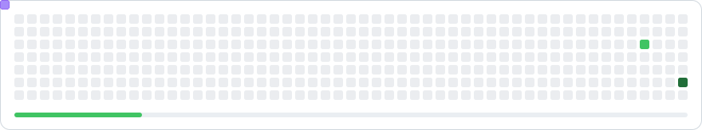

  <picture>
    <source media="(prefers-color-scheme: dark)" srcset="./assets/header-dark.svg" />
    <source media="(prefers-color-scheme: light)" srcset="./assets/header-light.svg" />
    
  </picture>

  
  

## 소개

안녕하세요

## 기술 스택

  <picture>
    <source media="(prefers-color-scheme: dark)" srcset="https://skillicons.dev/icons?i=python%2Cgo%2Cts%2Ckotlin%2Cfastapi%2Cnextjs%2Creact%2Cpostgres%2Credis%2Clinux%2Cdocker%2Cnginx%2Caws%2Cterraform%2Cbash%2Cgit&perline=8&theme=dark" />
    <source media="(prefers-color-scheme: light)" srcset="https://skillicons.dev/icons?i=python%2Cgo%2Cts%2Ckotlin%2Cfastapi%2Cnextjs%2Creact%2Cpostgres%2Credis%2Clinux%2Cdocker%2Cnginx%2Caws%2Cterraform%2Cbash%2Cgit&perline=8&theme=light" />
    
  </picture>

## GitHub 활동

<!-- ACTIVITY:START -->

  <picture>
    <source media="(prefers-color-scheme: dark)" srcset="./assets/activity-dark.svg" />
    <source media="(prefers-color-scheme: light)" srcset="./assets/activity-light.svg" />
    
  </picture>

<!-- ACTIVITY:END -->

<!-- SNAKE:START -->

  <picture>
    <source media="(prefers-color-scheme: dark)" srcset="./assets/snake-dark.svg" />
    <source media="(prefers-color-scheme: light)" srcset="./assets/snake-light.svg" />
    
  </picture>

<!-- SNAKE:END -->

## 공개 저장소

<!-- REPOS:START -->
<table>
  <thead>
    <tr>
      <th width="28%">Repository</th>
      <th width="46%">Description</th>
      <th width="14%">Language</th>
      <th width="12%">Updated</th>
    </tr>
  </thead>
  <tbody>
    <tr>
      <td><a href="https://github.com/sijogom/ecs-alb-express-demo"><strong>ecs-alb-express-demo</strong></a></td>
      <td>-</td>
      <td align="center"><code>JavaScript</code></td>
      <td align="center"><code>2026-10</code></td>
    </tr>
  </tbody>
</table>
<!-- REPOS:END -->
